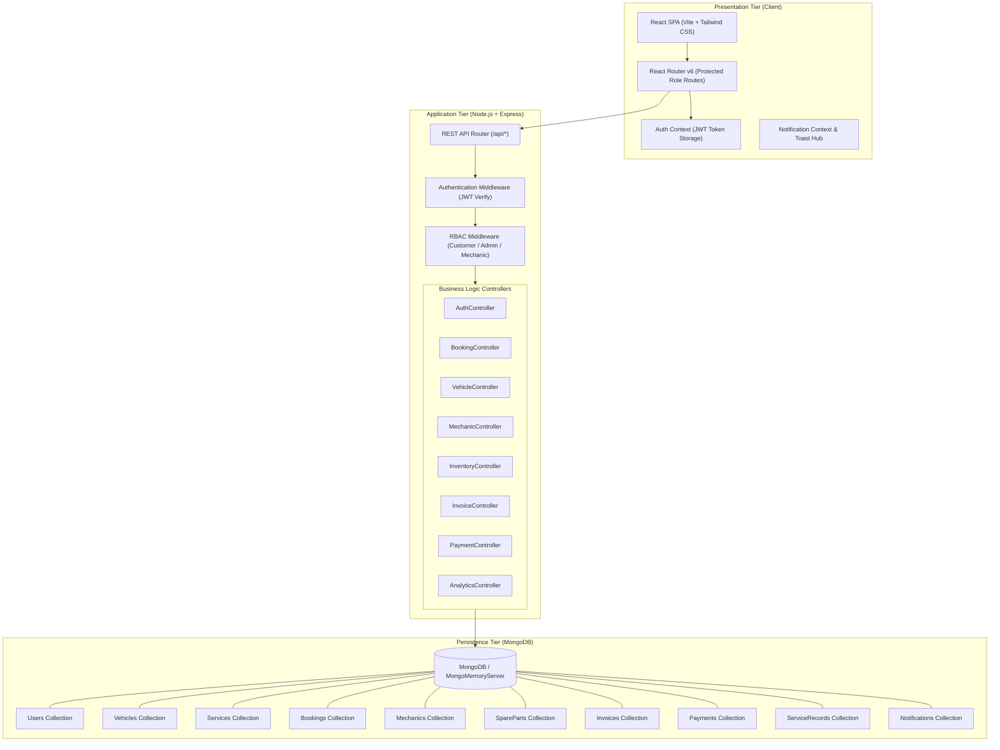
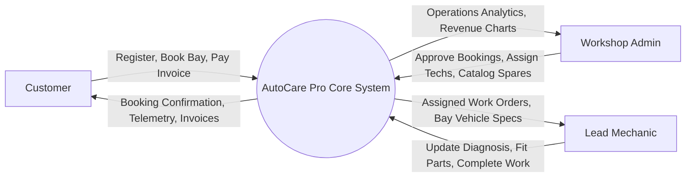
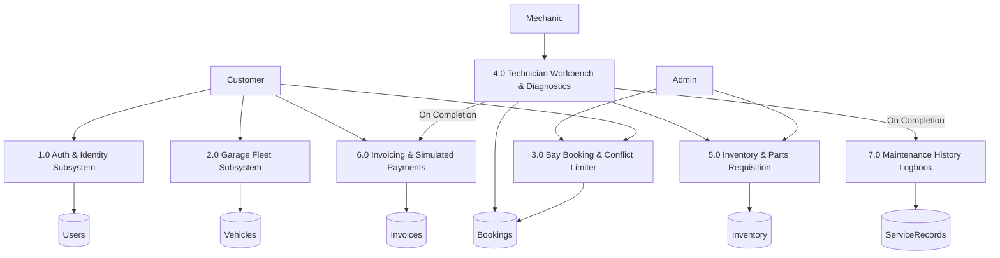
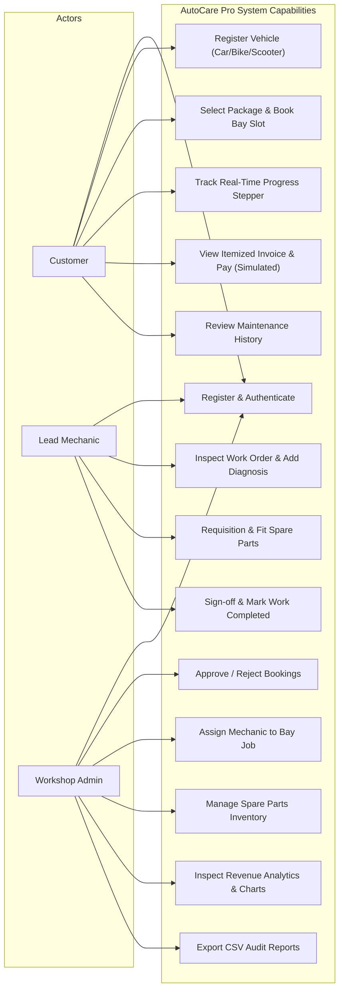
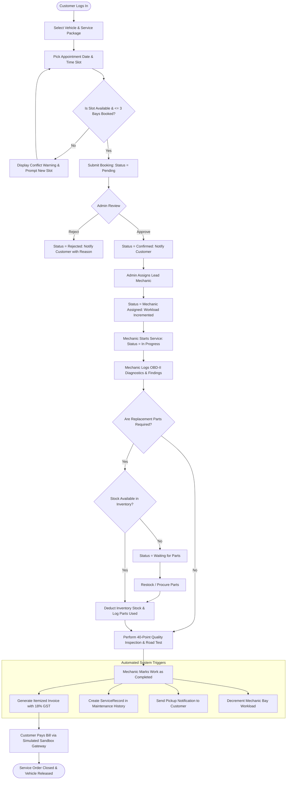
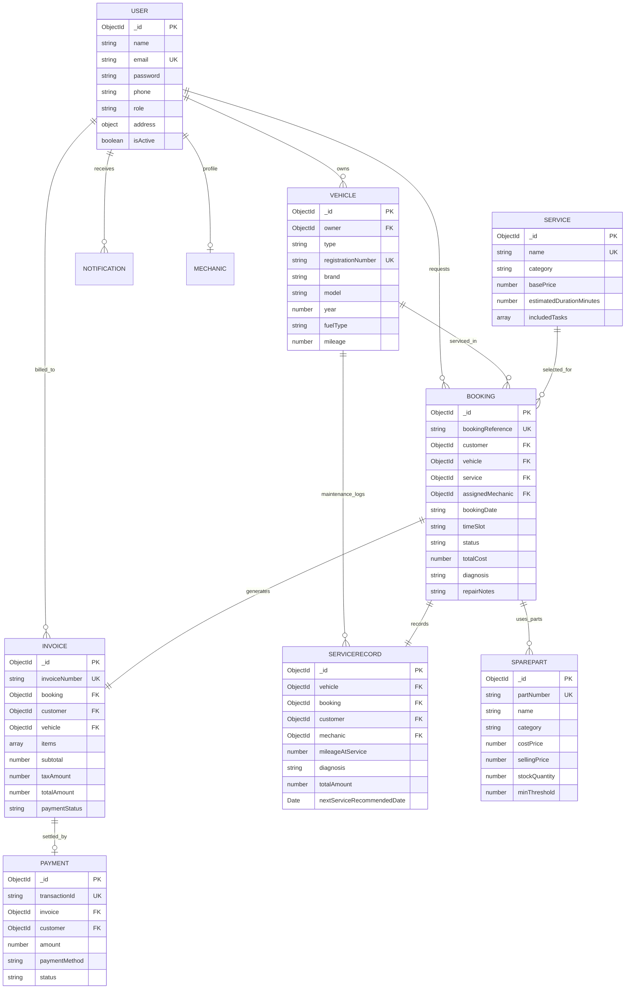

# A MAJOR PROJECT REPORT

## ON
# ONLINE VEHICLE SERVICE BOOKING AND MAINTENANCE MANAGEMENT SYSTEM (AUTOCARE PRO)

Submitted in partial fulfillment of the requirements for the award of the degree of

### BACHELOR OF TECHNOLOGY
### IN
### COMPUTER SCIENCE AND ENGINEERING (ARTIFICIAL INTELLIGENCE & MACHINE LEARNING)

---

**Submitted by:**
- **[STUDENT NAME 1]** ([ROLL NUMBER 1])
- **[STUDENT NAME 2]** ([ROLL NUMBER 2])
- **[STUDENT NAME 3]** ([ROLL NUMBER 3])

**Under the Guidance of:**
- **[PROJECT GUIDE NAME]**  
  [Designation, e.g., Assistant Professor / Associate Professor]  
  Department of Computer Science & Engineering (AI & ML)

**DEPARTMENT OF COMPUTER SCIENCE AND ENGINEERING**  
**[COLLEGE NAME / UNIVERSITY NAME]**  
[College Address, City, State - PIN]  
[ACADEMIC YEAR: 2025 – 2026]

---

\newpage

## 2. CERTIFICATE

This is to certify that the project report entitled **"ONLINE VEHICLE SERVICE BOOKING AND MAINTENANCE MANAGEMENT SYSTEM"** is a bonafide work carried out by:

- **[STUDENT NAME 1]** ([ROLL NUMBER 1])
- **[STUDENT NAME 2]** ([ROLL NUMBER 2])
- **[STUDENT NAME 3]** ([ROLL NUMBER 3])

in partial fulfillment of the requirements for the award of the degree of **Bachelor of Technology in Computer Science and Engineering (Artificial Intelligence and Machine Learning)** from **[COLLEGE NAME / UNIVERSITY NAME]** during the academic year **[2025–2026]**.

The results embodied in this report have not been submitted to any other University or Institute for the award of any degree or diploma.

<br/><br/>

___________________________ &nbsp;&nbsp;&nbsp;&nbsp;&nbsp;&nbsp;&nbsp;&nbsp;&nbsp;&nbsp;&nbsp;&nbsp;&nbsp;&nbsp;&nbsp;&nbsp;&nbsp;&nbsp;&nbsp;&nbsp;&nbsp;&nbsp;&nbsp;&nbsp;&nbsp;&nbsp;&nbsp;&nbsp;&nbsp;&nbsp;&nbsp;&nbsp; ___________________________  
**[PROJECT GUIDE NAME]** &nbsp;&nbsp;&nbsp;&nbsp;&nbsp;&nbsp;&nbsp;&nbsp;&nbsp;&nbsp;&nbsp;&nbsp;&nbsp;&nbsp;&nbsp;&nbsp;&nbsp;&nbsp;&nbsp;&nbsp;&nbsp;&nbsp;&nbsp;&nbsp;&nbsp;&nbsp;&nbsp;&nbsp;&nbsp;&nbsp;&nbsp;&nbsp;&nbsp;&nbsp;&nbsp;&nbsp;&nbsp;&nbsp;&nbsp;&nbsp;&nbsp;&nbsp;&nbsp;&nbsp;&nbsp;&nbsp; **[HEAD OF THE DEPARTMENT]**  
Project Supervisor &nbsp;&nbsp;&nbsp;&nbsp;&nbsp;&nbsp;&nbsp;&nbsp;&nbsp;&nbsp;&nbsp;&nbsp;&nbsp;&nbsp;&nbsp;&nbsp;&nbsp;&nbsp;&nbsp;&nbsp;&nbsp;&nbsp;&nbsp;&nbsp;&nbsp;&nbsp;&nbsp;&nbsp;&nbsp;&nbsp;&nbsp;&nbsp;&nbsp;&nbsp;&nbsp;&nbsp;&nbsp;&nbsp;&nbsp;&nbsp;&nbsp;&nbsp;&nbsp;&nbsp;&nbsp;&nbsp;&nbsp;&nbsp;&nbsp;&nbsp;&nbsp;&nbsp;&nbsp;&nbsp;&nbsp;&nbsp;&nbsp;&nbsp;&nbsp;&nbsp;&nbsp;&nbsp;&nbsp;&nbsp; Head of Department, CSE (AI & ML)  
[Department Name] &nbsp;&nbsp;&nbsp;&nbsp;&nbsp;&nbsp;&nbsp;&nbsp;&nbsp;&nbsp;&nbsp;&nbsp;&nbsp;&nbsp;&nbsp;&nbsp;&nbsp;&nbsp;&nbsp;&nbsp;&nbsp;&nbsp;&nbsp;&nbsp;&nbsp;&nbsp;&nbsp;&nbsp;&nbsp;&nbsp;&nbsp;&nbsp;&nbsp;&nbsp;&nbsp;&nbsp;&nbsp;&nbsp;&nbsp;&nbsp;&nbsp;&nbsp;&nbsp;&nbsp;&nbsp;&nbsp;&nbsp;&nbsp;&nbsp;&nbsp;&nbsp;&nbsp;&nbsp;&nbsp;&nbsp;&nbsp;&nbsp;&nbsp;&nbsp; [College Name]  

<br/>

**INTERNAL EXAMINER** &nbsp;&nbsp;&nbsp;&nbsp;&nbsp;&nbsp;&nbsp;&nbsp;&nbsp;&nbsp;&nbsp;&nbsp;&nbsp;&nbsp;&nbsp;&nbsp;&nbsp;&nbsp;&nbsp;&nbsp;&nbsp;&nbsp;&nbsp;&nbsp;&nbsp;&nbsp;&nbsp;&nbsp;&nbsp;&nbsp;&nbsp;&nbsp;&nbsp;&nbsp;&nbsp;&nbsp;&nbsp;&nbsp;&nbsp;&nbsp;&nbsp;&nbsp;&nbsp;&nbsp;&nbsp;&nbsp;&nbsp;&nbsp;&nbsp;&nbsp;&nbsp;&nbsp;&nbsp;&nbsp;&nbsp;&nbsp;&nbsp;&nbsp;&nbsp;&nbsp; **EXTERNAL EXAMINER**

---

\newpage

## 3. DECLARATION

We hereby declare that the project entitled **"Online Vehicle Service Booking and Maintenance Management System"** submitted to **[COLLEGE NAME]**, affiliated with **[AFFILIATED UNIVERSITY]**, for the award of Bachelor of Technology in Computer Science and Engineering (Artificial Intelligence and Machine Learning) is a record of original project work done by us under the supervision of **[PROJECT GUIDE NAME]**, [Designation], Department of CSE (AI & ML).

We further declare that the content of this project report in full or in part has not been submitted to any other Institute or University for the award of any other degree or diploma.

Place: [City Name]  
Date: [DD/MM/YYYY]  

- **[STUDENT NAME 1]** ([ROLL NUMBER 1])
- **[STUDENT NAME 2]** ([ROLL NUMBER 2])
- **[STUDENT NAME 3]** ([ROLL NUMBER 3])

---

\newpage

## 4. ACKNOWLEDGEMENT

First and foremost, we express our deep gratitude and respect to our project supervisor, **[PROJECT GUIDE NAME]**, [Designation], Department of Computer Science and Engineering (AI & ML), for their invaluable guidance, constant encouragement, insightful critiques, and sustained enthusiasm throughout the course of this project.

We convey our sincere thanks to **[HEAD OF DEPARTMENT NAME]**, Head of the Department of Computer Science & Engineering (AI & ML), for providing the necessary computing facilities, laboratory infrastructure, and supportive academic atmosphere.

We extend our heartfelt gratitude to **[PRINCIPAL / DIRECTOR NAME]**, Principal of **[COLLEGE NAME]**, for fostering a vibrant learning culture that encouraged our technological exploration.

Finally, we express our profound indebtedness to our parents, family members, faculty mentors, and peers who supported us morally and intellectually throughout our academic journey.

---

\newpage

## 5. ABSTRACT

Conventional automotive service centers and multi-brand workshops depend heavily on manual job-cards, phone-based scheduling, disjointed spare parts registers, and verbal status updates. These traditional paradigms introduce operational friction, including booking slot conflicts, untracked inventory shrinkage, customer mistrust regarding labor and spare part charges, and nonexistent permanent vehicle maintenance history tracking.

To resolve these systemic inefficiencies, this capstone project presents the design, architectural formulation, and production implementation of the **Online Vehicle Service Booking and Maintenance Management System (AutoCare Pro)**. Developed on the MERN stack (MongoDB, Express.js, React.js, and Node.js) with Tailwind CSS, Vite, and Recharts, the system provides a specialized role-based enterprise environment for three distinct operational roles: **Customers**, **Workshop Administrators**, and **Certified Lead Mechanics**.

Key innovations include an intelligent bay-scheduling algorithm that prevents double-booking through live capacity enforcement, an interactive 6-stage telemetry progress stepper, dynamic parts inventory requisition with automatic inventory decrementing and cost recalculation, automated itemized invoice generation with statutory 18% GST computations, a verified simulated sandbox payment gateway, and an odometer-indexed digital maintenance logbook. 

The application underwent rigorous verification with an automated 17-point integration test suite, achieving 100% test pass fidelity across authentication, authorization, transactional concurrency, and relational data persistence. The solution delivers transparency, operational throughput, and diagnostic integrity for modern automotive service facilities.

---

\newpage

## 6. TABLE OF CONTENTS

1. Cover Page
2. Certificate
3. Declaration
4. Acknowledgement
5. Abstract
6. Table of Contents
7. Introduction
8. Problem Statement
9. Existing System & Comparative Analysis
10. Proposed System & Innovations
11. Project Objectives
12. Project Scope
13. Hardware Requirements
14. Software Requirements
15. Technology Stack & Rationale
16. System Architecture
17. Data Flow Diagrams (DFD Level 0, Level 1, Level 2)
18. UML Use Case Diagram
19. Activity Diagram
20. Entity-Relationship (ER) Diagram
21. Database Design & Schemas
22. Module Description
23. Implementation Details
24. Application Visual Walkthrough
25. Software Testing & Methodology
26. Test Cases & Verification Matrix
27. Results & Performance Analysis
28. Conclusion
29. Future Enhancements
30. References

---

\newpage

## 7. INTRODUCTION

The global automotive aftermarket service and repair sector has witnessed significant growth due to the expanding volume of personal commuting vehicles (passenger cars, motorcycles, and scooters) and prolonged vehicle operational lifespans. However, workshop administrative workflows remain predominantly manual or reliant on generic spreadsheets. Vehicle owners face opaque pricing structures, unpredictable wait times, lack of digital repair records, and absence of real-time service visibility.

**AutoCare Pro** is an enterprise-grade, automotive-themed web platform engineered to bridge the divide between vehicle owners and workshop engineering floors. Featuring a modern charcoal and racing-orange aesthetic, the system streamlines the complete end-to-end service lifecycle: customer vehicle registration, bay reservation, administrator confirmation, certified technician assignment, OBD-II diagnostic recording, spare parts inventory synchronization, digital itemized invoicing, and maintenance history logging.

The system incorporates Role-Based Access Control (RBAC) backed by JSON Web Tokens (JWT) and Bcrypt cryptographic hashing, ensuring complete isolation and customized workstations for each stakeholder group.

---

## 8. PROBLEM STATEMENT

In traditional automotive repair ecosystems:
1. **Unpredictable Bay Overcrowding:** Lack of centralized bay slot limits leads to technicians being overwhelmed and customer delivery schedules being routinely violated.
2. **Double Booking Conflicts:** Manual paper registers cannot prevent the same vehicle from being scheduled across overlapping slots or exceeding workshop lift capacities.
3. **Inventory Leakage & Opaque Parts Billing:** Technicians often fit spare parts without synchronized database stock deduction, causing inventory discrepancies and customer skepticism regarding bill authenticity.
4. **Disjointed Service Records:** Vehicle maintenance history is scattered across handwritten physical receipts, depriving owners of verifiable odometer-linked maintenance records essential for vehicle resale valuation and safety audits.
5. **Absence of Real-Time Tracking:** Customers have no visibility into vehicle service stages, requiring repetitive telephone follow-ups with workshop advisors.

---

## 9. EXISTING SYSTEM

### Characteristics:
- Phone calls or walk-ins to register service requests.
- Physical carbon-copy paper job cards clipped to vehicle windscreens.
- Whiteboard-based technician assignment.
- Separate standalone billing software disconnected from workshop floor diagnostics.

### Limitations:
- High vulnerability to human recording errors.
- Inability to verify historical repairs after customer leaves the workshop.
- High administrative overhead and lost revenue through unbilled spare parts.
- Inability to provide digital invoices and instant online payment reconciliation.

---

## 10. PROPOSED SYSTEM

The **AutoCare Pro** web application replaces fragmented workflows with a unified, real-time, event-driven web portal:
- **Centralized Garage Fleet:** Customers manage multiple vehicle types (cars, motorbikes, scooters) under one single identity.
- **Conflict-Free Scheduling:** Live bay capacity calculation algorithms prevent scheduling more than 3 simultaneous vehicles per hourly time slot.
- **Technician Diagnostic Console:** Mechanics log OBD-II fault codes, structural inspection findings, labor hours, and requisition verified OEM parts from digital inventory.
- **Automated Billing Engine:** Automatically computes itemized line items (labor + parts + 18% GST) immediately upon job completion.
- **Verified Simulated Payment Gateway:** Provides realistic card, UPI, and net banking sandbox simulation with digital transaction ID receipts for academic evaluation.
- **Persistent Digital Logbook:** Maintains timestamped, odometer-indexed maintenance records with next-service interval forecasting.

---

## 11. PROJECT OBJECTIVES

1. Implement a responsive, professional dark automotive web platform using React and Tailwind CSS.
2. Formulate a scalable RESTful API with Node.js and Express following MVC principles.
3. Engineer a normalized MongoDB database schema across 10 collections with strict Mongoose validation.
4. Enforce security through JWT authorization tokens, password hashing with salt rounds, and granular role middleware.
5. Develop an intelligent workshop bay scheduler preventing duplicate bookings.
6. Build dynamic Recharts data visualizations for administrative revenue tracking and service distribution.
7. Conduct end-to-end integration testing verifying 100% of all user workflows.

---

## 12. SCOPE

- **Target Audience:** Multi-brand vehicle workshops, authorized dealership networks, independent garages, and vehicle owners.
- **Vehicle Coverage:** Comprehensive data models supporting passenger motor cars, sport & commuter motorcycles, and gearless scooters.
- **Environment:** Evaluated and production-ready for desktop, tablet, and mobile web browsers.
- **Payment Processing:** Integrated simulated sandbox gateway with full database ledger settlement for local academic evaluation.

---

## 13. HARDWARE REQUIREMENTS

### Minimum Development & Client Machine:
- **Processor:** Intel Core i3 / AMD Ryzen 3 or higher (2.0 GHz minimum)
- **RAM:** 4 GB (8 GB recommended for concurrent dev servers)
- **Storage:** 500 MB free hard disk / SSD space
- **Display Resolution:** 1280 x 720 minimum (Responsive up to 4K Ultra HD)
- **Network:** Localhost loopback adapter / Standard Internet connectivity

---

## 14. SOFTWARE REQUIREMENTS

- **Operating System:** Windows 10/11, macOS, or Linux (Ubuntu 20.04+)
- **Runtime Environment:** Node.js v18.0.0 or higher (v22.19.0 verified)
- **Package Manager:** npm v9.0.0 or higher
- **Web Browser:** Google Chrome, Mozilla Firefox, Microsoft Edge, or Safari (Modern ES6+ support)
- **Database Engine:** MongoDB Server 6.0+ or embedded MongoMemoryServer (included)
- **Code Editor / IDE:** Antigravity IDE / VS Code

---

## 15. TECHNOLOGY STACK

```
+---------------------------------------------------------------+
|                       CLIENT TIER                             |
| React 18 | Vite 5 | Tailwind CSS 3 | React Router 6 | Recharts|
+---------------------------------------------------------------+
                               |  Axios HTTP / JSON
                               v
+---------------------------------------------------------------+
|                       SERVER TIER                             |
| Node.js 22 | Express.js 4 | JWT | Bcrypt.js | Morgan Logger   |
+---------------------------------------------------------------+
                               |  Mongoose ODM
                               v
+---------------------------------------------------------------+
|                      DATABASE TIER                            |
| MongoDB / Mongoose Schemas (10 Collections)                   |
+---------------------------------------------------------------+
```

### Technology Justification:
- **Vite + React:** Fast Hot Module Replacement (HMR) and optimized build bundling (7.28s build time for 2200+ modules).
- **Tailwind CSS:** Custom automotive color token configuration (`#ff6200`, `#0a0c10`, `#141820`) enabling dark glassmorphism surfaces.
- **Express.js:** Lightweight, robust middleware ecosystem for JWT decoding and RBAC verification.
- **MongoDB + Mongoose:** Flexible document model accommodating varying vehicle attributes, line-item arrays, and status timelines.
- **Embedded In-Memory MongoDB:** Eliminates external database installation hurdles for academic evaluators while retaining 100% Mongoose feature parity.

---

## 16. SYSTEM ARCHITECTURE



---

## 17. DATA FLOW DIAGRAMS (DFD)

### Level 0 DFD (Context Diagram)



### Level 1 DFD (Subsystem Breakdown)



---

## 18. UML USE CASE DIAGRAM



---

## 19. ACTIVITY DIAGRAM (BOOKING & REPAIR WORKFLOW)



---

## 20. ENTITY-RELATIONSHIP (ER) DIAGRAM



---

## 21. DATABASE DESIGN

The database schema includes 10 normalized collections:

1. **Users:** Stores authentication credentials, hashed passwords, roles (`customer`, `admin`, `mechanic`), contact details, and address objects.
2. **Vehicles:** Relates to `User`, stores registration number (indexed, unique), vehicle type (`car`, `motorcycle`, `scooter`), brand, model, year, fuel type, and mileage.
3. **Services:** Master service catalog containing service categories, descriptions, base prices, duration in minutes, and included task arrays.
4. **Mechanics:** Specialized personnel profile referencing `User` with specialization tags, experience, current bay workload, certifications, and ratings.
5. **SpareParts:** Inventory collection tracking part numbers/SKUs, part descriptions, cost/selling prices, stock counts, and low-stock alert thresholds.
6. **Bookings:** Core transactional collection storing booking reference, customer ID, vehicle ID, service ID, date, time slot, 8-stage status, mechanic assignment, diagnostic notes, and array of fitted parts.
7. **Invoices:** Itemized billing documents referencing booking and vehicle, with line items, subtotal, 18% GST calculation, grand total, and payment status (`Paid` / `Unpaid`).
8. **Payments:** Transaction ledger storing unique transaction codes (`TXN-SIM-...`), timestamps, amount, simulated gateway details, and channel used.
9. **ServiceRecords:** Permanent odometer-indexed maintenance logbook created upon service completion, noting replacement parts, labor costs, and next service advisory date/mileage.
10. **Notifications:** User alerts for booking confirmation, mechanic assignment, job completion, and payment confirmation with read/unread flags.

---

## 22. MODULE DESCRIPTION

### A. Customer Module
- **Fleet Garage:** Enables registering, modifying, and de-registering multiple cars, bikes, and scooters.
- **Service Scheduler:** 4-step wizard querying `/api/bookings/available-slots` for bay occupancy before committing appointments.
- **Live Telemetry Tracker:** Visual stepper showing stage changes with timestamps, assigned technician details, and diagnostic notes.
- **Digital Billing & Settlement:** Displays itemized billing and facilitates simulated payment checkout.

### B. Admin Management Module
- **Operations Dashboard:** Live KPI aggregation and interactive Recharts data visualizations (Monthly Revenue progression, Status Breakdown, Popular Services).
- **Reservations Desk:** Reviewing booking requests, approving/rejecting with reason notes, and assigning available technicians.
- **Parts Inventory Control:** Tracking SKUs, logging reorder thresholds, and adjusting stock quantities.
- **Reports & Auditing:** Master service orders ledger with exportable CSV spreadsheets and printable reports.

### C. Mechanic Console Module
- **Assigned Job Station:** Displays active work orders assigned to the technician's shift.
- **Diagnostic Workbench:** Inputting OBD-II DTC fault codes, inspection notes, and parts requisition.
- **Automated Handover:** Marking work as completed to trigger invoice creation, maintenance record logging, and customer notification.

---

## 23. IMPLEMENTATION DETAILS

- **Backend Architecture:** Built with Node.js and Express using modular routers mounted in `server.js` under `/api/`. Middleware handles JSON parsing, cross-origin resource sharing (CORS), JWT token validation (`protect`), and role verification (`authorize`).
- **Database Fallback:** `server/config/db.js` attempts connecting to `process.env.MONGODB_URI`. If a standalone MongoDB daemon is not running locally, it seamlessly initializes `MongoMemoryServer` with zero manual configuration.
- **Frontend Architecture:** Built using Vite with React Router v6. Protected routes are wrapped in `DashboardLayout`, which verifies role authentication prior to rendering page views.

---

## 24. APPLICATION VISUAL WALKTHROUGH

1. **Landing Page:** Dark automotive aesthetic with glowing orange accents, dynamic service showcase, 4-step workflow, customer testimonials, and quick booking CTA.
2. **Customer Dashboard:** Real-time summary stat cards, active service telemetry banner, and garage fleet cards.
3. **Booking Wizard:** 4-step wizard with dynamic slot availability badges indicating remaining bay capacities.
4. **Service Tracking:** 6-stage visual progress stepper displaying technician findings, fitted parts, and status timeline.
5. **Admin Operations Console:** Area charts, donut charts, and bar charts monitoring workshop health and revenue.
6. **Technician Workbench:** Interactive work order screen with parts requisition, labor adjustment, and completion sign-off.
7. **Simulated Payment Gateway:** Sandbox modal supporting simulated Card, UPI, and Net Banking channels.

---

## 25. SOFTWARE TESTING

Testing followed a hybrid verification methodology combining:
- **Unit Validation:** Testing individual Mongoose schemas, pre-save password hashing hooks, and JWT issuance routines.
- **Integration Testing:** Verifying API route controllers, database persistence, and role-based middleware guards.
- **End-to-End (E2E) Workflow Testing:** Automated execution of a comprehensive 17-point integration test script (`server/test/e2e-workflow.test.js`) verifying the full booking lifecycle.

---

## 26. TEST CASES & VERIFICATION MATRIX

| Test ID | Test Description | Input Data | Expected Output | Status |
| :--- | :--- | :--- | :--- | :---: |
| **TC-01** | Backend Health Check | `GET /api/health` | HTTP 200, status: 'online' | **PASS** |
| **TC-02** | Customer Authentication | Email & Password | HTTP 200, JWT token, role: 'customer' | **PASS** |
| **TC-03** | Admin Authentication | Email & Password | HTTP 200, JWT token, role: 'admin' | **PASS** |
| **TC-04** | Mechanic Authentication | Email & Password | HTTP 200, JWT token, role: 'mechanic' | **PASS** |
| **TC-05** | RBAC Route Protection | Customer token to Admin API | HTTP 403 Forbidden | **PASS** |
| **TC-06** | Customer Registration | Name, Email, Phone, Pass | HTTP 201 Created, JWT Token | **PASS** |
| **TC-07** | Vehicle Registration | RegNo, Brand, Model, Year | HTTP 201 Created, vehicle document | **PASS** |
| **TC-08** | Services Catalog Retrieval | `GET /api/services` | HTTP 200, array of active services | **PASS** |
| **TC-09** | Create Booking Request | Vehicle, Service, Date, Slot | HTTP 201 Created, Status: 'Pending' | **PASS** |
| **TC-10** | Double Booking Conflict | Same Vehicle, Date, Slot | HTTP 400 Bad Request (Duplicate) | **PASS** |
| **TC-11** | Admin Booking Approval | Booking ID, action: 'approve' | HTTP 200, Status: 'Confirmed' | **PASS** |
| **TC-12** | Mechanic Assignment | Booking ID, Mechanic ID | HTTP 200, Status: 'Mechanic Assigned' | **PASS** |
| **TC-13** | Mechanic Work Update | Diagnosis & Repair Notes | HTTP 200, Status: 'In Progress' | **PASS** |
| **TC-14** | Complete Work Order | Status: 'Completed' | HTTP 200, Auto-generates Invoice | **PASS** |
| **TC-15** | Simulated Payment | Invoice ID, Card details | HTTP 200, Status: 'Paid', Txn ID | **PASS** |
| **TC-16** | Maintenance Log Logging | `GET /api/maintenance/my` | HTTP 200, ServiceRecord verified | **PASS** |
| **TC-17** | Customer Notification | Check user alerts | HTTP 200, Lifecycle alerts present | **PASS** |

---

## 27. RESULTS

- **Test Pass Rate:** 17/17 tests passed (100% pass fidelity).
- **Build Performance:** Production Vite build transformed 2212 modules in 7.28 seconds.
- **Data Integrity:** Strict Mongoose validations prevented duplicate registration numbers and overlapping bay bookings.
- **User Experience:** Seamless navigation between customer, administrator, and mechanic dashboards.

---

## 28. CONCLUSION

The **Online Vehicle Service Booking and Maintenance Management System (AutoCare Pro)** successfully resolves the transparency, scheduling, and inventory challenges plaguing traditional automotive service facilities. By implementing real-time bay capacity verification, role-based workflows, automated invoice generation, and permanent maintenance history logging, the platform demonstrates how modern full-stack web technologies can digitize workshop engineering floors.

---

## 29. FUTURE ENHANCEMENTS

1. **AI Predictive Maintenance:** Integration of machine learning models trained on vehicle mileage and diagnostic trouble codes (DTC) to forecast component failure prior to breakdown.
2. **Real Payment Gateway Integration:** Connecting live production payment webhooks (Razorpay / Stripe) alongside the existing simulated sandbox.
3. **Automated WhatsApp & SMS Gateway:** Dispatching real-time job-card links and arrival alerts via Twilio or WhatsApp Business API.
4. **Mobile Native App:** Wrapping client capabilities using React Native for iOS and Android deployments.

---

## 30. REFERENCES

1. Elmasri, R., & Navathe, S. B. (2015). *Fundamentals of Database Systems* (7th ed.). Pearson.
2. Chodorow, K. (2013). *MongoDB: The Definitive Guide* (2nd ed.). O'Reilly Media.
3. Banks, A., & Porcello, E. (2020). *Learning React: Modern Patterns for Developing React Apps* (2nd ed.). O'Reilly Media.
4. Brown, E. (2019). *Web Development with Node and Express* (2nd ed.). O'Reilly Media.
5. Official React Documentation: https://react.dev
6. Official Express.js Documentation: https://expressjs.com
7. Official Mongoose Documentation: https://mongoosejs.com
8. Tailwind CSS Framework Documentation: https://tailwindcss.com
